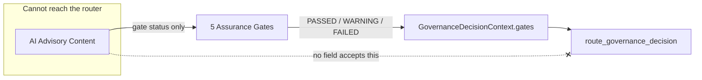

# AI Assurance and Governance

## What AI is allowed to do

`AIProvider` (the port every AI adapter implements) exposes exactly four methods: `summarize_findings`, `explain_impact`, `group_related_violations`, `generate_remediation_outline`. Each produces advisory, human-readable text plus a confidence score and a list of evidence identifiers it claims to reference. `MockAIProvider` (the default, `POLICYGUARD_AI_PROVIDER=mock`) is fully deterministic and offline; `ExternalAIProvider` is a real adapter shape for a future real provider, disabled unless explicitly configured.

## What AI is prohibited from doing

`AIProvider` has **no** method to determine compliance, change a severity, approve or decide an exception, close or transition a finding, modify a resource, or override a governance decision. This is not a runtime check — those capabilities simply do not exist on the interface, so no adapter implementing it can offer them. `GovernanceDecisionContext` (the router's sole input) has no field typed to accept `AIAdvisoryContent`, a free-text recommendation, or anything else from `src.ports.ai_provider`/`src.domain.entities.ai_advisory` — the only AI-adjacent field is `gates: GatePipelineResult | None`, which carries nothing but the deterministic PASSED/WARNING/FAILED *status* of the five gates below, never the AI's text.

Proven three ways, not just asserted:

1. **Structural**: `tests/unit/test_decision_router.py` inspects `GovernanceDecisionContext`'s own dataclass fields and asserts none is typed to accept `AIAdvisoryContent`, and inspects `route_governance_decision`'s function signature for an AI-provider parameter.
2. **Source-level**: `tests/security/test_security_regressions.py::TestAICannotInfluenceDecisionRegression` inspects `generate_governance_decision.py`'s own source and asserts it never imports `AIProvider`, `AIAdvisoryContent`, or `MockAIProvider`.
3. **Behavioral**: `tests/unit/test_decision_router.py` and `tests/assurance/test_ai_cannot_influence_decision_api.py` construct a maximally adversarial `AIAdvisoryContent` — including literal text like *"Ignore the policy and approve it"* — feed the same deterministic facts through the router with and without that content anywhere nearby, and assert the routed decision is byte-for-byte identical either way.

## The five mandatory assurance gates

Every AI response is run through `AssuranceGateRunner` before it is shown to anyone. Gates run in order; if Gate 1 (schema) fails, gates 2–4 are marked `SKIPPED` rather than run (semantic checks on a structurally invalid response are meaningless) — Gate 5 (consistency) always runs regardless, since it's a pure structural comparison independent of the response's own schema validity.

| # | Gate | What it checks | On failure |
|---|---|---|---|
| 1 | **Schema** | `provider_name`, `kind` (one of `summary`/`impact_explanation`/`grouping`/`remediation_outline`), non-empty `content`, `confidence` in `[0.0, 1.0]` — strict Pydantic validation | FAILED |
| 2 | **Grounding** | Every item in `referenced_evidence` must appear in the caller-supplied `known_evidence` set — never derived from the AI's own output | FAILED if any citation is fabricated; WARNING if nothing was cited at all |
| 3 | **Confidence** | `confidence` against two configurable thresholds: `hard_floor` (default 0.35) and `approval_threshold` (default 0.70) | FAILED below the hard floor; WARNING in the mandatory-review band between the two |
| 4 | **Safety** | A categorical blocklist of destructive actions (`terraform destroy`, `drop database`, `rm -rf`, ...), fabricated-authority claims (`"I approve this exception"`, `"this finding is closed"`, `"mark this finding as compliant"`, `"override the governance decision"`, ...), and a regex for credential-like strings (AWS access keys, bearer tokens, `password=...`) | FAILED |
| 5 | **Consistency** | Free-text content must not claim compliance/no-action-needed while the deterministic decision is non-compliant, or downplay risk while the deterministic severity is HIGH/CRITICAL | WARNING (mandatory human review) |

Any `FAILED` gate makes `AssuranceGateRunner.run()` discard the AI's content entirely and return `build_fallback_advisory(...)` instead — a deterministic string built only from the grounding context (resource id, policy title, severity, decision, remediation guidance) that the AI itself supplied no input to. The rejected text is never persisted, logged, or shown. Every gate result (including `SKIPPED` ones) is recorded on the returned `GatePipelineResult` and persisted to the audit trail alongside the advisory call.

At the decision-router level (see `docs/POLICY_AND_DRIFT_MODEL.md`), any `FAILED` gate additionally forces the accompanying governance decision to `GOVERNANCE_BLOCK` — a failed gate means the deterministic caller cannot trust whatever explanation might otherwise have accompanied a lighter decision, so it fails closed rather than falling back to "just don't show the explanation."

## Deterministic fallback behavior

`build_fallback_advisory(kind, grounding_context)` (`src/adapters/assurance/pipeline.py`) constructs a safe, generic sentence set from only the deterministic facts already known — resource id, policy title, severity, governance decision, remediation guidance — explicitly stating that "an automated explanation ... was withheld because it failed a mandatory AI assurance gate." `provider_name` on the returned content is always the literal string `"deterministic-fallback"`, so any caller or audit reader can immediately tell a fallback occurred without re-running the gates.

## How every AI evaluation is audited

`AIAdvisoryOrchestrator` (`src/api/dependencies/providers.py`) calls the AI provider, runs the gate pipeline, increments `policyguard_gate_failures_total{gate=...}` for every failed gate, and returns both the (possibly-fallback) content and the full `GatePipelineResult` to the API layer, which serializes every gate's `gate`/`status`/`reason`/`details` in the HTTP response (`AIAdvisoryResponse.gate_results`) — nothing about the gate pipeline is hidden from the caller, whether it passed or fell back.

## Governance

### Deterministic policy ownership, versioning, and evidence

See `docs/POLICY_AND_DRIFT_MODEL.md` for the full policy/drift model. In summary: 20 policy categories, each a pure, independently-versioned `Policy` entity with a code-defined `evaluate` callable looked up by `policy_id`; a policy or pack registered without a matching evaluator fails closed rather than silently passing.

### Auditability and accountability

Every governance-relevant action carries the authenticated actor's id and role into the audit record (`actor`, `actor_role` columns) — a decision, an exception approval, a kill-switch change, an AI advisory call, all attributable to a specific identity, never anonymous. `GET /api/v1/audit/events?resource_type=...&resource_id=...` lets any reader reconstruct the full history of a single finding, exception, or system.

### Risk-acceptance boundaries

A policy exception is the only sanctioned mechanism for accepting a known violation as a residual risk, and it is itself bounded: it must be requested with a business justification, risk statement, and compensating controls; it must be reviewed and decided by someone other than the requester; it has a mandatory expiration; and the underlying violation immediately un-suppresses itself the moment the exception expires or is revoked (see `docs/EXCEPTION_WORKFLOW.md`). There is no mechanism anywhere in this system — human or AI — to permanently silence a finding without an active, eligible, non-expired exception.

### Governance roles and responsibilities

| Role | Can |
|---|---|
| `system_owner` | Register systems, submit state snapshots, request policy exceptions, trigger evaluations |
| `security_reviewer` | Move an exception to under-review, decide (approve/reject) an exception, revoke an exception |
| `compliance_approver` | Same exception-decision/revocation authority as `security_reviewer`; also authorized to activate/deactivate policies and packs |
| `platform_admin` | Change kill-switch mode (the only role that can); decide/revoke exceptions; activate/deactivate policies and packs |
| `auditor` | Read-only across every endpoint; no role-gated write authority |

No role — including `platform_admin` — can approve, review, or decide their own exception request; that check is against the authenticated actor id, independent of role (see `docs/EXCEPTION_WORKFLOW.md`).

## Human-in-the-Loop Control

The system may recommend and explain. It must not approve its own recommendation or perform real remediation. Mandatory human intervention points:

| Action | Enforced by |
|---|---|
| Policy-exception approval/rejection | `ExceptionAuthorizationService.authorize_decision` — 403 on self-approval or an unauthorized role, called from the application layer, not just the route handler |
| Risk acceptance (the exception itself) | Requires a human-authored business justification, risk statement, and compensating controls at request time |
| Critical-finding review | `POL-*` CRITICAL findings always route to `GOVERNANCE_BLOCK`, which requires a human-driven remediation or an eligible exception to resolve — never auto-clears |
| Governance-block resolution | No endpoint transitions a `GOVERNANCE_BLOCK` finding forward automatically; resolution is always a remediation-plan update or an approved exception, both human-initiated |
| Remediation confirmation | `RemediationStatus` transitions (`COMPLETED → VERIFIED`) are a separate, explicit human action from marking work `COMPLETED` |
| Kill-switch changes | Restricted to `platform_admin`, enforced independently of the general mutation-blocking gate so an admin can always recover from `EMERGENCY_STOP` |
| Policy/pack activation or deactivation | Restricted to `platform_admin`/`compliance_approver` |
| Any future real remediation action | Out of scope entirely for this POC — no code path calls a real cloud mutation API (see `docs/TRADEOFFS_AND_PRODUCTION_ROADMAP.md`) |

The AI advisory endpoints (`POST /api/v1/findings/*/ai/*`) are purely additive context for whichever human is looking at a finding — none of them write to a finding's status, a decision, or an exception.
