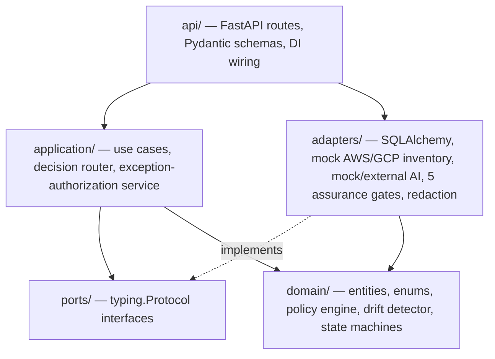
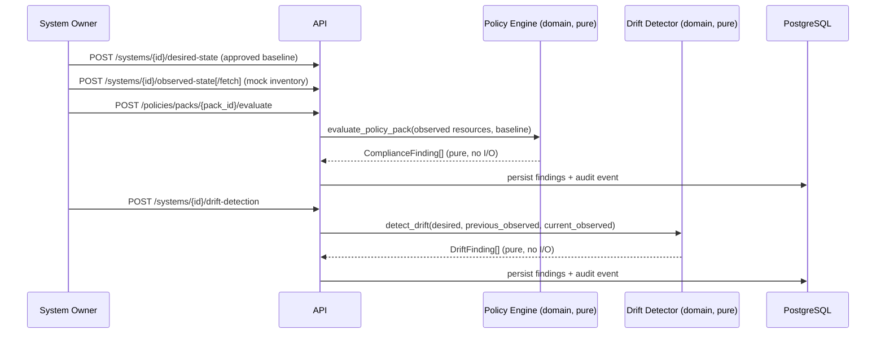
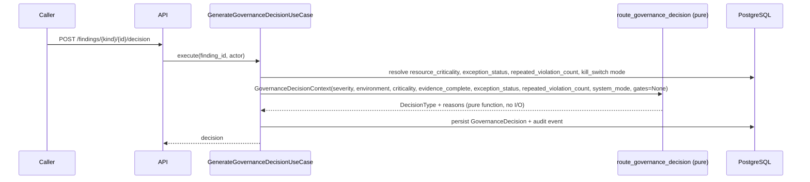
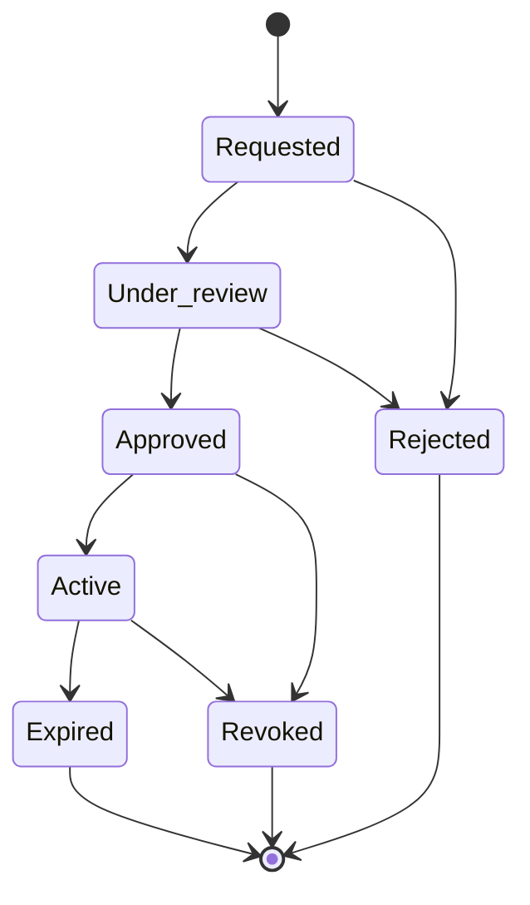

# Architecture

## Clean Architecture boundaries

PolicyGuard is a modular monolith with strict, one-directional dependencies:

Dependencies point inward only. `domain/` imports nothing outside itself — no FastAPI, SQLAlchemy, Pydantic, Alembic, uvicorn, psycopg, or boto3/google-cloud anywhere in that package (grep-verified; every domain module also imports successfully with zero third-party dependencies installed). `application/` depends on `domain/` and on `ports/` (interfaces, never concrete adapters) — a use case is wired to a concrete `SqlAlchemyXRepository` only through FastAPI's dependency-injection layer in `api/dependencies/`, never by importing it directly. `adapters/` is the only package that knows about SQLAlchemy, HTTP-mockable cloud inventory, or an AI SDK.

This means the entire policy engine, drift detector, decision router, and state machines are pure functions of their inputs: no I/O, no clock reads beyond an injected clock, no randomness beyond an injected id factory, testable without a database or a running server (and largely without even installing FastAPI/SQLAlchemy — see `tests/unit/`).

## Layer responsibilities

| Layer | Responsibility | Key modules |
|---|---|---|
| `domain/` | Entities (frozen dataclasses), enums, the 20-policy engine, the 8-type drift detector, the 4 explicit state machines, separation-of-duties and kill-switch pure policy functions, the audit hash-chain algorithm | `policy_engine/definitions.py`, `drift/detector.py`, `state_machine/*.py`, `policies/*.py` |
| `application/` | Use cases (one per spec workflow step), the pure decision router, the exception-authorization service | `use_cases/*.py`, `routing/decision_router.py`, `services/exception_authorization.py` |
| `ports/` | `Protocol`/ABC interfaces every repository, the AI provider, and the cloud-inventory provider must satisfy | `*_repository.py`, `ai_provider.py`, `cloud_inventory_provider.py` |
| `adapters/` | Concrete implementations: SQLAlchemy repositories + ORM models, `MockAWSInventoryProvider`/`MockGCPInventoryProvider`, `MockAIProvider`/`ExternalAIProvider`, the 5 `AssuranceGate` implementations, secret redaction | `persistence/`, `cloud/`, `ai/`, `assurance/`, `security/redaction.py` |
| `api/` | FastAPI routers, strict Pydantic request/response schemas (`extra="forbid"`), dependency wiring, kill-switch gating dependencies, the AI advisory orchestrator | `routes/*.py`, `schemas/*.py`, `dependencies/*.py` |
| `observability/` | Structured JSON logging, correlation-ID propagation, Prometheus metrics | `logging.py`, `correlation.py`, `metrics.py` |
| `infrastructure/` (`Dockerfile`, `docker-compose.yml`, `migrations/`, `infrastructure/{aws,gcp}/`) | Execution environment — never imported by application code | — |

## PostgreSQL persistence

Every repository port has exactly one SQLAlchemy 2.x implementation in `src/adapters/persistence/`. There is no in-memory or SQLite path anywhere in the shipped application — `tests/fixtures/fake_repositories.py` provides pure in-memory fakes for `tests/application/`'s use-case-orchestration tests, but every integration/API/security/e2e test runs against a real, disposable `postgres:16` container. The schema (12 tables) is generated by one real Alembic migration (`migrations/versions/e62918b59be8_initial_schema.py`), not `Base.metadata.create_all()` at app boot — a missing migration surfaces as a clear failure at request time (repository/table-not-found), never as silently-recreated tables.

Value objects (resource attributes, exception evidence lists, gate results) are stored as JSONB rather than normalized into further tables — this schema has no foreign keys; each row is looked up and cross-referenced by application-level id (`resource_id`, `finding_id`, `policy_id`) rather than a database-enforced join. This keeps the migration and mapping layer small at the cost of database-level referential integrity, an explicit, documented trade-off for a POC of this scope (see `docs/TRADEOFFS_AND_PRODUCTION_ROADMAP.md`).

## AWS and GCP normalization

`CloudResource` (domain entity) and `ResourceType` (10 provider-independent categories: `IAM_ROLE`/`IAM_BINDING`, `SECURITY_GROUP`/`FIREWALL_RULE`, `OBJECT_STORAGE_BUCKET`, `RELATIONAL_DATABASE`, `CONTAINER_SERVICE`, `SECRETS_REFERENCE`, `AUDIT_LOG_CONFIG`, `MONITORING_CONFIG`) are the normalization boundary. `MockAWSInventoryProvider` and `MockGCPInventoryProvider` (both implementing the `CloudInventoryProvider` port) each translate their cloud's native resource shapes into this same normalized model before anything downstream ever sees them — the policy engine, drift detector, and decision router have no branch anywhere that checks "is this AWS or GCP." See `docs/MULTI_CLOUD_REFERENCE.md` for the exact AWS↔GCP↔ResourceType mapping table.

## Main evaluation flow

## Decision flow

`GovernanceDecisionContext` has no field typed to accept AI output — see `docs/AI_ASSURANCE_AND_GOVERNANCE.md` for the full structural guarantee.

## Exception workflow

Every transition into "decide" (approve/reject) and "revoke" is checked by `ExceptionAuthorizationService`, which is called from the application-layer use cases — not just from the API route handlers — so the rule cannot be bypassed by a future endpoint that forgets to check. Full detail in `docs/EXCEPTION_WORKFLOW.md`.

## Audit flow

Every governance-relevant action — a policy/drift evaluation, a governance decision, an AI advisory call and its gate results, every exception-workflow transition, every kill-switch change — is appended to `audit_events` through one repository method (`AuditEventRepository.append`), which:

1. Redacts the payload (`redact_mapping`) before anything else touches it.
2. Canonicalizes it to deterministic JSON (`sort_keys=True`).
3. Computes `current_hash = SHA256(previous_hash + canonical_payload)`, chaining to the immediately preceding record (or a genesis hash of all zeros for the first record).
4. Persists sequence, hashes, redacted canonical payload, and outcome — all inside one transaction with a `SELECT ... FOR UPDATE`-style lock on the latest row, so concurrent writers cannot race and produce two records both claiming the same `previous_hash`.

`GET /api/v1/audit/verify` recomputes every hash in sequence order and reports the first sequence at which a stored hash disagrees with the recomputed one, a `previous_hash` doesn't match the prior record's `current_hash`, or a sequence number is skipped — detecting tampering, reordering, and deletion alike.

## Trust boundaries

- **Client → API**: actor identity arrives as two headers (`X-PolicyGuard-Actor`/`X-PolicyGuard-Role`), parsed into the domain's own `Actor` entity, never trusted for anything the client also claims in the request body (e.g. `requested_by` on an exception request is compared against the authenticated actor and rejected on mismatch).
- **API → domain/application**: every inbound schema is `extra="forbid"`; unknown fields are a 422, not silently ignored.
- **Application → adapters**: only through `ports/` interfaces; a use case never imports a concrete SQLAlchemy class or the AI SDK directly.
- **Adapters → external systems**: `MockAWSInventoryProvider`/`MockGCPInventoryProvider` never make a real network call to AWS/GCP; `MockAIProvider` never makes a real network call to any LLM API. `ExternalAIProvider` exists as a disabled stub — enabling it is an explicit configuration change, not a default.
- **AI → decision**: structurally impossible to cross — see `docs/AI_ASSURANCE_AND_GOVERNANCE.md`.

## External provider boundaries

No code path in this repository calls a real AWS, GCP, or third-party LLM API by default. `MockAIProvider` (`POLICYGUARD_AI_PROVIDER=mock`, the default) is fully deterministic and offline — every test and the demo script run against it. `ExternalAIProvider` is a real adapter shape (implements the same `AIProvider` port) but is inert unless `POLICYGUARD_AI_PROVIDER=external` plus a base URL and API key are explicitly configured — this repository never ships or requires either. Terraform in `infrastructure/{aws,gcp}/` describes a reference deployment topology and is validated (`fmt`, `init -backend=false`) but never `apply`'d by anything in this repository or its CI.
