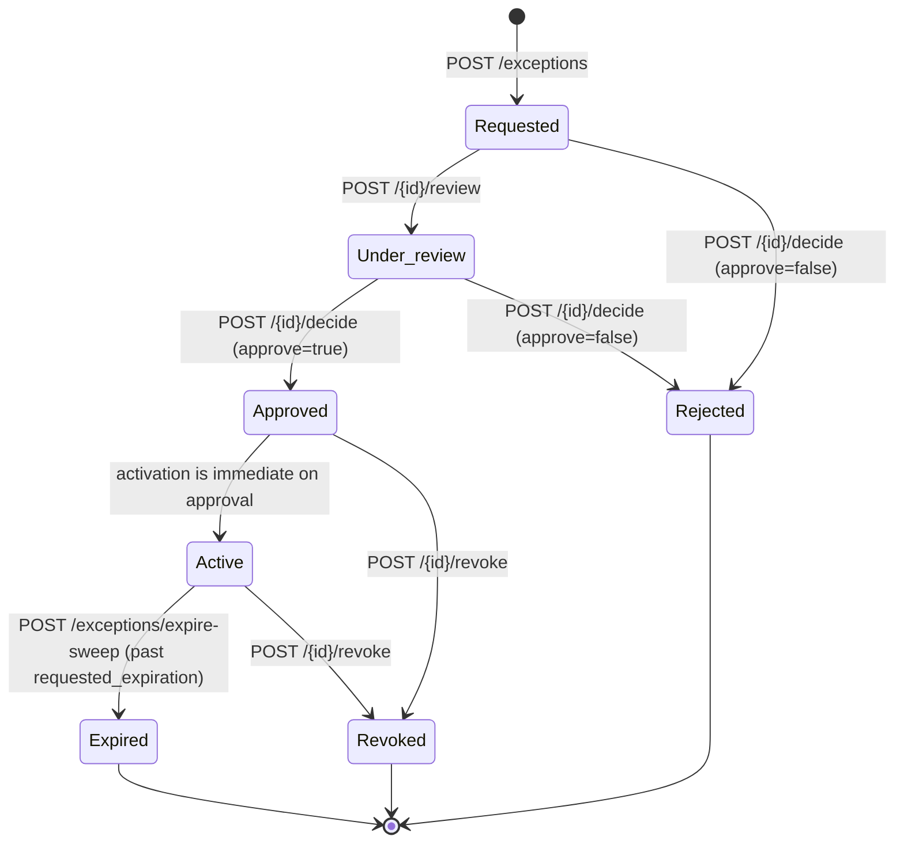

# Policy Exception Workflow

## Lifecycle

`src/domain/state_machine/exception_transitions.py` is the single, explicit allow-list every transition is checked against (`InvalidStateTransitionError` on anything not listed — fail closed). `Rejected`, `Expired`, and `Revoked` are terminal: there is no path back to `Active` from any of them, which is what makes demo scenario 12 (expired exception causing a new violation) meaningful — a finding cannot be re-suppressed by resurrecting an old exception, only by requesting a fresh one.

## Requesting an exception

`POST /api/v1/exceptions` requires `policy_id`, `resource_id`, `finding_id`, `managed_system_id`, a `business_justification`, a `risk_statement`, `compensating_controls`, a `requested_expiration` timestamp, and supporting `evidence`. Only policies with `exception_eligible=True` can be requested against — see `docs/POLICY_AND_DRIFT_MODEL.md` for which of the 20 default policies are eligible.

## Spoofed-identity prevention

The request schema accepts an optional `requested_by` field — what the client *claims* the requester is. `RequestPolicyExceptionUseCase` never trusts it on its own: `ExceptionAuthorizationService.authorize_request` compares it against the *authenticated* actor id (from the `X-PolicyGuard-Actor` header) and raises `ExceptionAuthorizationError` (→ HTTP 403) on any mismatch. A client cannot request an exception on someone else's behalf by simply naming them in the body. Regression-tested in `tests/security/test_security_regressions.py::TestSpoofedIdentityRegression` and exercised live in demo scenario 13's sibling check.

## Separation of duties

`src/domain/policies/separation_of_duties.py` is the single source of truth for two rules, both enforced through `ExceptionAuthorizationService` — called from the application-layer use cases, not only from route handlers, so a future endpoint cannot accidentally bypass them:

- **`can_decide_exception`**: the actor deciding (review, approve, or reject) an exception can never be the same actor id that requested it, *regardless of role* — even a `platform_admin` cannot approve their own request. Checked before the role check, so the error message is specific ("requester cannot review, approve, or reject their own exception") rather than a generic authorization failure.
- **`can_revoke_exception`**: restricted to `security_reviewer`, `compliance_approver`, or `platform_admin`.

Decision-making roles (`EXCEPTION_DECISION_ROLES`): `security_reviewer`, `compliance_approver`, `platform_admin`. `system_owner` and `auditor` cannot decide or revoke an exception.

Demonstrated live: demo scenario 13 has the requester (`demo.owner`) attempt to decide their own exception under an authorized role (`compliance_approver`) and confirms the API rejects it with HTTP 403.

## Expiration and revocation

`POST /api/v1/exceptions/expire-sweep` scans every `Active` exception, transitions any past its `requested_expiration` to `Expired`, and returns the list of newly-expired exceptions — restricted to `platform_admin` in the demo/reference deployment pattern (any authenticated actor can call it; a real deployment would schedule it, not expose it for ad-hoc human triggering). Revocation (`POST /{id}/revoke`) is an explicit human action available on `Approved` or `Active` exceptions, requiring a `reason`, and is restricted to the same decision-making roles.

Critically: the moment an exception leaves `Active` (whether by expiry or revocation), `route_governance_decision` (step 6/7 in `docs/POLICY_AND_DRIFT_MODEL.md`'s routing rules) no longer sees `exception_status in (ACTIVE, APPROVED)` for that finding — the underlying violation is re-evaluated on its own merits on the very next evaluation run, producing a fresh, unsuppressed finding rather than silently staying hidden. This is exercised end-to-end (not just unit-tested) by demo scenario 12: an exception is created already expired, approved anyway, swept, and a re-evaluation of the same resource confirms a new `POL-NET-001` finding for the same policy/resource pair.

## What "approved" does not mean

Approving an exception does not modify the resource, close the finding permanently, or remove the finding from future evaluation runs — the policy engine still evaluates the resource every time it's asked to; the *decision router* is what treats an active/eligible exception's match as `OBSERVATION_RECORDED` instead of `REMEDIATION_REQUIRED`/`GOVERNANCE_BLOCK`. An exception is a governance annotation on top of deterministic evaluation, never a bypass of it.
